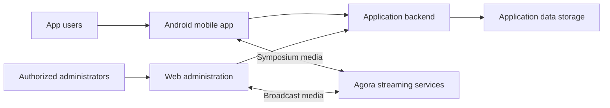

# AGP Limited — OBS Power Pack

**Role:** Android and backend developer

**Published application:** [OBS Power Pack on Google Play](https://play.google.com/store/apps/details?id=com.obs.powerpack)

## Purpose

Provide a company mobile application with symposium streaming and supporting administrative workflows.

## My contribution

- Built the Android application and backend functionality.
- Integrated symposium streaming using Agora and WebRTC.

## Technology

The reviewed project includes a React Native/Expo mobile application, a Next.js administration and API application, PostgreSQL through Prisma, and Agora streaming components. The mobile project also uses embedded web content for parts of its experience.

## Simplified architecture

Streaming relationships are simplified, including interactions mediated by embedded web content. Internal administration routes, user records, and service credentials are excluded.

[Back to all projects](../README.md)
