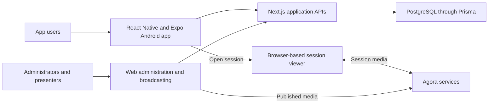

# AGP Limited — OBS Power Pack

**My role:** Android and backend developer

**Published application:** [OBS Power Pack on Google Play](https://play.google.com/store/apps/details?id=com.obs.powerpack)

## Project context

OBS Power Pack combines a company mobile application with administrative workflows and symposium streaming. The project includes a mobile client, web administration, backend services, persistent application data, and a browser-based live-session experience.

This project came through Softsols Pakistan. My documented contribution is Android and backend development, including Agora/WebRTC streaming integration.

## My contribution

- Built the Android application and backend functionality.
- Integrated symposium streaming using Agora and WebRTC.

The technical overview includes components in the wider source tree. It does not imply sole authorship of every administrative feature or of the third-party streaming service.

## Live-session workflow

1. The mobile app retrieves session information and presents scheduled or live sessions.
2. When a session link is available, the user can open it from the app. The reviewed implementation opens a browser-based session experience using Expo's browser integration.
3. The web streaming application obtains the information needed to join an Agora session.
4. A presenter uses the web interface to publish media, and the viewer receives the stream through Agora.
5. Application services manage session records separately from the media connection.

The mobile session code also sends an attendance request when joining. That is evidence of an application event, not proof that a participant watched an entire session or completed a training requirement.

## Architecture

| Component | Responsibility |
| --- | --- |
| Android app | Presents application features and provides a route into sessions. |
| Administration and APIs | Manage application records, session information, and streaming integration. |
| Browser session experience | Provides the viewer's media interface. |
| Agora | Carries the streaming media between participants. |
| Database | Persists application data and session-related records. |

## Engineering details

**Application state and media state.** Session records and their status are managed through application APIs. Publishing and receiving audio/video use the streaming SDK. Separating these responsibilities makes it possible to describe a session in the app without treating the database as a media transport.

**Browser-only media SDK.** The reviewed broadcasting interface dynamically loads Agora in the browser because the SDK depends on browser APIs. It creates a live-mode client, joins as a host, and publishes local media tracks.

**Mobile-to-web handoff.** The mobile app's session screen delegates viewing to a browser-based experience. This is an integration between the mobile and web components, rather than evidence of a native React Native Agora player.

## Technology and evidence

The available implementation uses React Native, Expo, TypeScript, Next.js, Prisma, PostgreSQL, and Agora's Web SDK. The Google Play listing is linked above. No audience-size, latency, uptime, or viewing-completion claims are made without supporting measurements.

[Back to all projects](../README.md)
