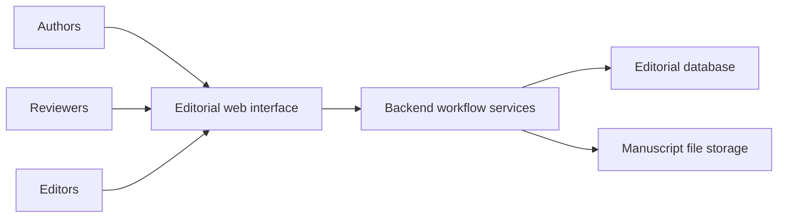

# Pakistan Journal of Pharmaceutical Sciences

**Role:** Database and backend lead

**Public website:** [pjps.pk](https://pjps.pk)

## Purpose

Support the journal's editorial process, connecting manuscript submission, peer review, editorial decisions, and publication.

## My contribution

- Built the database and backend workflows for the editorial management system.
- Implemented manuscript storage and workflows connecting authors, reviewers, and editors.
- Handled server deployment under the oversight of the journal's Editor-in-Chief.

## Technology

The reviewed application uses Next.js and TypeScript, Prisma with PostgreSQL, and S3-compatible file storage integrations.

## Simplified architecture

The diagram shows component responsibilities without revealing manuscript contents, reviewer identities, database schemas, or storage locations.

[Back to all projects](../README.md)
