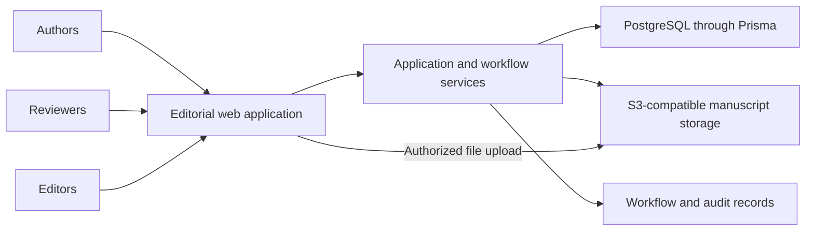

# Pakistan Journal of Pharmaceutical Sciences

**My role:** Database and backend lead

**Public website:** [pjps.pk](https://pjps.pk)

## Project context

An editorial management system needs to keep manuscripts, authors, reviewers, files, revisions, and editorial decisions connected as an article moves toward publication. A manuscript can return for revision, require another review round, or stop at an editorial decision. The database and backend therefore need to represent a continuing workflow rather than a single upload form.

This project came through Softsols Pakistan. My work was carried out under the oversight of the journal's Editor-in-Chief, Prof. Dr. Muhammad Harris Shoaib.

## My contribution

- Built the database and backend workflows for the editorial management system.
- Implemented manuscript storage and workflows connecting authors, reviewers, and editors.
- Handled server deployment for the system.

## Main workflow

1. **Submission:** An author supplies manuscript information and associated files.
2. **Editorial handling:** The system records the article's workflow state and editorial assignments.
3. **Peer review:** Assigned reviewers submit recommendations and comments, including separate comments for the author and editor.
4. **Revision and decision:** Review records and article state support subsequent rounds and editorial decisions.
5. **Production and publication:** The wider application includes proofreading, galley, issue, and publication workflows.

This is a summary of supported stages, not a claim that every manuscript follows an identical sequence.

## Architecture

The database holds structured article and workflow information. File storage holds manuscript-related objects. The upload implementation can issue a signed upload URL, allowing file transfer to storage while the application manages the surrounding workflow.

## Engineering details visible in the code

**Consistent review completion.** The reviewed submission handler groups review finalization, article-state updates, and reviewer metrics in a database transaction. That groups related changes so they can succeed or fail together. It also checks the assignment and review state before finalizing a review.

**Revision-aware assignments.** Review handling distinguishes review records associated with an article, including records from different rounds. This matters because the same reviewer may encounter a revised version of the same manuscript.

**Editorial allocation.** An assignment helper considers active editor workload and excludes the submitter and matching co-author emails from candidate editors. These are application-level checks; this description does not imply a comprehensive conflict-of-interest review.

**Files and editorial metadata.** Keeping files in object storage and their relationships in the database gives the application separate responsibilities for file transfer and editorial workflow. Audit records provide an additional record of selected actions.

## Technology and public evidence

The reviewed implementation uses Next.js, TypeScript, Prisma, PostgreSQL, and S3-compatible storage integration. The public journal website is linked above. Manuscripts, reviewer identities, editorial correspondence, storage locations, and production configuration are excluded from this repository.

[Back to all projects](../README.md)
