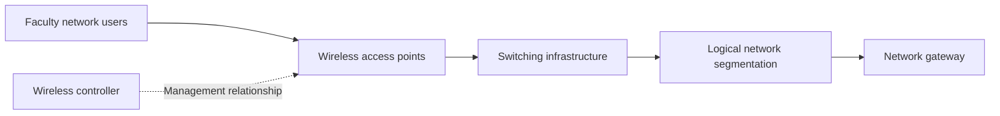

# Faculty of Pharmacy and Pharmaceutical Sciences

**Institution:** University of Karachi

**My role:** Network infrastructure lead and web developer

## Project context

This work covered two distinct needs: wireless connectivity across faculty offices and departments, and a website presenting the faculty's academic work and facilities. The network work involved configuring infrastructure on site; the website work involved designing and building the faculty's online presentation.

## My contribution

- Configured Ruckus wireless controllers and more than 20 access points.
- Worked on switches and VLAN configuration for connectivity across the Dean's Office and five departments.
- Independently designed and built the faculty website.
- Used photographs of faculty facilities to present its academic environment.

The project came through Softsols Pakistan. These responsibilities are recorded in my activity descriptions; this public repository does not contain equipment inventories, configuration exports, or a site survey.

## Network architecture

This is a conceptual view of the components involved. Logical segmentation is shown separately for explanation; it is not a claim that a particular appliance or switch occupies that position in the physical network. The controller arrow represents management, not an assertion that all user traffic passes through the controller.

## What the components contribute

| Component | Function in the network |
| --- | --- |
| Access points | Provide the wireless connection used by client devices. |
| Wireless controller | Supports management of the wireless access infrastructure. |
| Switching | Connects access infrastructure to the wider wired network. |
| VLAN configuration | Defines logical segments within the network. |
| Gateway | Represents onward connectivity from the local network. |

These explanations describe the purpose of the technologies used. They do not claim a particular VLAN-to-department mapping, security policy, or traffic-routing design.

## Website work

The website was a separate deliverable, designed to present the faculty's academic work and facilities through its pages and photographs. My documented role was independent design and development of that website.

The available project folder also includes academic portal and examination-system implementations. This overview keeps those distinct from the faculty website and network responsibilities recorded in my activities, rather than attributing every later portal feature to the original work.

## Scope and evidence

The reported scope covers the Dean's Office, five departments, and more than 20 access points. This describes the installation work, not a measured coverage, throughput, or uptime result. No radio survey results or before/after benchmarks are claimed here.

Ruckus controllers and access points, switching, and VLAN configuration are the documented infrastructure technologies. Exact equipment locations, management addresses, network identifiers, and administrative settings remain outside this public overview.

[Back to all projects](../README.md)
