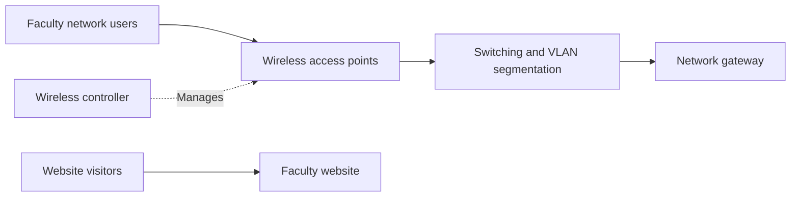

# Faculty of Pharmacy and Pharmaceutical Sciences

**Institution:** University of Karachi

**Role:** Network infrastructure lead and web developer

## Purpose

Provide wireless connectivity across the Dean's Office and five faculty departments, and present the faculty's academic work and facilities online.

## My contribution

- Configured Ruckus controllers, more than 20 access points, switches, and VLANs.
- Independently designed and built the faculty website.
- Used photographs of faculty facilities to present its academic environment.

## Technologies and concepts

Ruckus wireless controllers and access points, switching, VLAN configuration, and website development.

## Conceptual architecture

The website is shown separately from the campus network. This is a conceptual diagram, with no building layout, equipment addresses, VLAN identifiers, or management interfaces.

[Back to all projects](../README.md)
