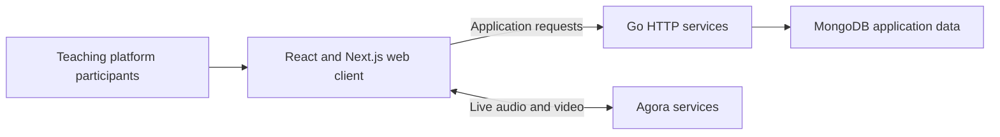

# RESPIRE Teaching Platform

**My role:** Backend developer

**Project context:** University of Edinburgh / NIHR RESPIRE

**Public website:** [respiredigitalhub.org](https://respiredigitalhub.org)

## Project context

The platform combines digital teaching features with live audio/video communication. Those functions involve two different kinds of work: application services that process requests and persist teaching data, and media components that manage microphones, cameras, and live participants.

## My contribution

- Wrote Go backend services for the teaching platform.
- Integrated the Agora API for WebRTC-based live video-call sessions.

The broader source includes frontend, persistence, and communication components. The contribution described here is backend development and calling integration, rather than sole authorship of the entire platform.

## Representative workflows

### Teaching data

The reviewed course-creation handler validates a request, checks the requesting user's administrative role, constructs course metadata, and persists the course in MongoDB before returning a response. This is a concrete example of the Go service work supporting the platform's teaching features.

### Live calling

1. The browser initializes a calling client.
2. Camera and microphone tracks are created for the participant.
3. The client joins an Agora channel and publishes local tracks.
4. Remote audio/video tracks are received and presented in the interface.
5. Microphone, camera, and disconnect controls update the participant's session.

The reviewed calling components also include cleanup of local media resources when leaving. This matters because a call ending in the interface should also release the associated camera and microphone tracks.

## Architecture

| Path | Responsibility |
| --- | --- |
| Web client to application services | Request and update platform data. |
| Application services to persistence | Store structured teaching records. |
| Web client to Agora | Publish and receive live media. |

The diagram intentionally separates application requests from media traffic. It does not represent video as passing through the Go API, and it does not establish the complete deployed network topology.

## Engineering details

**Request handling and validation.** The Go course handler separates validation, permission checks, metadata construction, and database writes. Invalid input or an unsuitable role produces an error response rather than creating the course.

**Media lifecycle.** Calling components manage local and remote tracks separately, with controls for changing participant media state and releasing tracks on disconnect.

**Integration scope.** Agora provides the media service; my work integrated that service into the platform. This overview does not imply that I built a WebRTC transport or media server from scratch.

## Technology and evidence

The available project includes Go, Gorilla HTTP routing, MongoDB, React/Next.js, and Agora React/Web SDK components. The public platform link is provided above. No latency, concurrency, uptime, or clinical-outcome figures are claimed without measurement evidence.

[Back to all projects](../README.md)
