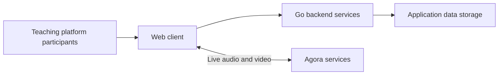

# RESPIRE Teaching Platform

**Role:** Backend developer

**Project context:** University of Edinburgh / NIHR RESPIRE

**Public website:** [respiredigitalhub.org](https://respiredigitalhub.org)

## Purpose

Support digital teaching and live video-call sessions for the RESPIRE platform.

## My contribution

- Wrote Go backend services.
- Integrated Agora for live audio and video communication through WebRTC.

## Technology

The reviewed project includes Go HTTP and WebSocket services, MongoDB persistence, a React/Next.js web client, and Agora calling components. My contribution focused on the backend services and calling integration.

## Simplified architecture

Application requests and media communication are shown as separate connections. The diagram omits account configuration, room identifiers, and operational infrastructure.

[Back to all projects](../README.md)
