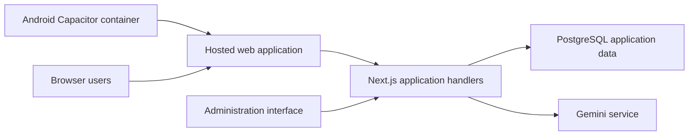

# ReDerm — Pakistan Association of Dermatologists

**My role:** Android developer and AI integration

**Public application:** [ReDerm Connect](https://rederm-connect.vercel.app)

## Project context

ReDerm combines professional membership features with an AI-assisted clinical information interface for dermatologists. It brings member access, professional content, and an AI interaction surface into a web application that is also delivered through an Android container.

## My contribution

- Built the Android application and integrated Google Gemini assistance.
- Worked on medical guardrails and communicating uncertainty in the AI interface.
- Worked on the professional registration and PMDC-related access workflow.

The implementation details below describe what is visible in the available source. They do not establish clinical validation or the accuracy of an AI response.

## Main workflows

### Registration and member access

The reviewed registration workflow records professional details, including a PMDC identifier, and supports administrator approval. The login handler accepts an email address or PMDC identifier, checks the password against its stored hash, and checks approval status before issuing a member session.

This source establishes identifier-based access and administrator approval. It does not, by itself, establish automated verification against an official external PMDC registry.

### AI-assisted information

1. A user submits a question through the application.
2. The application sends the message to a backend handler.
3. The handler calls Gemini with instructions framing the response as dermatology assistance and requesting a clinical-correlation disclaimer.
4. The generated text is returned to the interface.

The reviewed handler responds to the latest supplied message. A message array in its request format is not evidence that it passes the entire conversation history to the model.

## Architecture

The Android configuration loads the hosted application in a Capacitor container. Membership and AI requests are handled by the web application's backend rather than by a separately documented native Android backend.

## Engineering details

**Shared application delivery.** React/Next.js supplies the web interface, while Capacitor provides the Android container. This architecture shares the hosted application experience across browser and Android entry points; it does not imply that every screen is implemented as a native Android view.

**Professional access workflow.** Registration records, approval actions, and login state connect the membership process to application access. The source includes server-side password comparison and session issuance.

**AI boundaries.** Gemini is called from a backend handler, with the service key read from server-side configuration. The prompt includes a clinical disclaimer. Prompt instructions are a limited application measure, not a guarantee of correctness, safe recommendations, or specialist judgment.

## Technology and evidence

The reviewed implementation uses Next.js, React, TypeScript, Capacitor for Android, PostgreSQL, and Google's Gemini SDK. The public application is linked above. This repository excludes member information, clinical conversations, internal prompts, credentials, and operational configuration.

[Back to all projects](../README.md)
