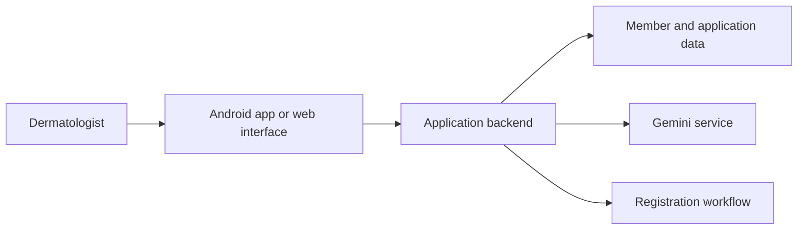

# ReDerm — Pakistan Association of Dermatologists

**Role:** Android developer and AI integration

**Public application:** [ReDerm Connect](https://rederm-connect.vercel.app)

## Purpose

Provide a professional application for dermatologists, with member features and an AI-assisted clinical information interface.

## My contribution

- Built the Android application and integrated Google Gemini assistance.
- Worked on medical guardrails and communicating uncertainty in the AI interface.
- Implemented PMDC registration checks as part of the professional access workflow.

## Technology

The reviewed implementation combines Next.js, React, and TypeScript with Capacitor for Android, PostgreSQL for application data, and a server-side Gemini integration.

## Simplified architecture

AI assistance is one part of the application workflow. The diagram omits prompts, member records, verification details, and service configuration; it does not imply clinical validation.

[Back to all projects](../README.md)
