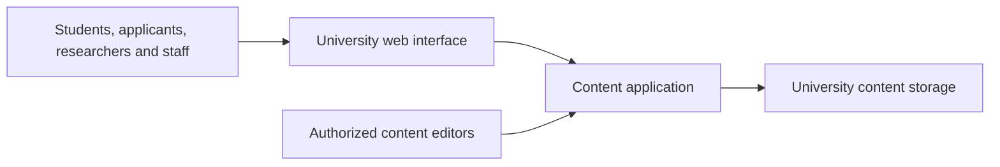

# University of Karachi Website

**Role:** Main front-end developer

**Public website:** [uok.edu.pk](https://uok.edu.pk)

## Purpose

Provide students, applicants, researchers, and staff with access to university information through the institution's official website.

## My contribution

- Built the website's front end.
- Translated requirements from Admissions, Examinations, and the Vice Chancellor's office into accessible pages.
- Helped organize homepage priorities around audience needs and the timing of university announcements.

## Technology

The reviewed website implementation uses Next.js, React, and TypeScript. Its wider application includes content administration and database-backed content; my stated role here is the front end.

## Simplified architecture

The diagram illustrates how public pages connect to managed content. It omits internal services and deployment details.

[Back to all projects](../README.md)
