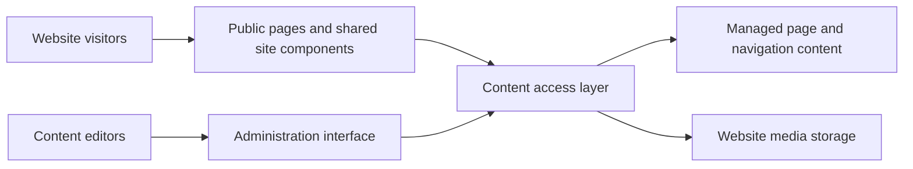

# University of Karachi Website

**My role:** Main front-end developer

**Public website:** [uok.edu.pk](https://uok.edu.pk)

## Project context

The university website serves several audiences with different priorities: applicants looking for admissions information, students checking examinations and announcements, researchers exploring academic work, and staff sharing institutional updates. The front end needs to make those routes understandable while accommodating changing content from university offices.

This project came through Softsols Pakistan. My work involved translating requirements from Admissions, Examinations, and the Vice Chancellor's office into accessible pages and helping reconcile homepage priorities around audience needs and timing.

## My contribution

- Built the front end of the official university website.
- Turned office requirements into page layouts and navigation suited to the intended audience.
- Helped organize homepage content so that university announcements and audience needs could be considered together.

The technical overview below also describes supporting content-management components visible in the available project. My stated contribution is the front end; the presence of a backend component does not imply that I independently built every part of it.

## How the website works

1. A visitor enters through the homepage or a direct page link.
2. Shared site components provide the header, navigation, news ticker, and footer.
3. Content pages and homepage sections present university information through a consistent interface.
4. Administrative screens support maintaining pages, menus, news, slides, and other content used by the public website.

The reviewed implementation supports nested menus and configurable homepage sections. This allows content organization to be represented as application data instead of requiring every navigation change to be hardcoded into the public interface.

## Architecture

| Component | Responsibility |
| --- | --- |
| Public interface | Presents university information and helps visitors navigate between audiences and topics. |
| Shared components | Keep the header, footer, ticker, and surrounding page structure consistent. |
| Content administration | Provides editing interfaces for the content consumed by public pages. |
| Persistence and media | Store structured content and associated website files. |

## Engineering details

**Navigation across a large institution.** The reviewed menu implementation supports parent/child relationships, ordering, and external destinations. This accommodates university information that lives both within the main website and on separate institutional sites.

**Content and presentation.** Homepage section configuration and shared components allow the interface to present different types of information while keeping a consistent layout. The requirements work involved deciding which information should be prominent and how visitors should reach it.

**Scope of the public record.** The source supports a description of the interface and content system. This overview does not claim an accessibility certification or a measured improvement in performance or engagement.

## Technology and evidence

The reviewed implementation uses Next.js, React, TypeScript, and Prisma-backed content access. The public website is linked above; technology details describe the available project code rather than asserting the exact version currently deployed.

[Back to all projects](../README.md)
